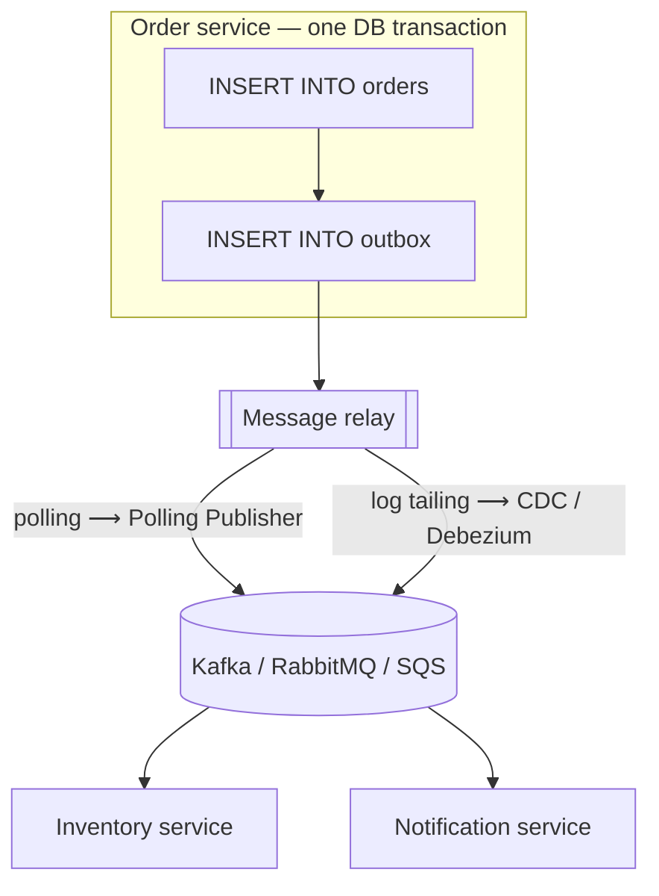

Almost every event-driven microservice eventually writes code like this:

```java
orderRepository.save(order);                 // 1. commit to the database
kafkaTemplate.send("orders", orderPlaced);   // 2. publish to the broker
```

It looks harmless. It's one of the most common sources of data inconsistency in distributed systems. The **Transactional Outbox** pattern fixes it by making the event part of the same database transaction as the data.

## The problem: dual writes

Writing to two systems — a database and a message broker — without a shared transaction creates two failure windows:

| Failure | Result |
|---|---|
| DB commit succeeds, process crashes before publish | Order exists, **no event**. Downstream services never learn about it. |
| Publish succeeds, DB commit fails or rolls back | Event says order placed, but **the order doesn't exist**. Downstream services act on a lie. |
| Publish inside the DB transaction, then DB commit fails | Same as above — the broker can't un-send. |

Wrapping both in XA ([Two-Phase Commit](/blog/two-phase-commit/)) isn't an option with Kafka, and is costly elsewhere. Retrying the publish on failure doesn't help if the process dies.

## How it works

1. In the **same local transaction** as the business change, insert a row into an **outbox table** describing the event.
2. A separate **message relay** reads unpublished outbox rows and publishes them to the broker.
3. After the broker acknowledges, the relay marks the rows as published (or deletes them, or simply advances a log position).



Because the outbox row commits **atomically** with the order, there are only two possible states: both exist, or neither does. The relay then guarantees the event is *eventually* published — at least once.

The two relay strategies each have their own deep dive: [Polling Publisher](/blog/polling-publisher/) and [Change Data Capture](/blog/change-data-capture/).

## Example: Spring Boot + PostgreSQL

### The outbox table

```sql
CREATE TABLE outbox (
  id              UUID PRIMARY KEY,
  aggregate_type  VARCHAR(64)  NOT NULL,   -- e.g. 'Order'   → topic routing
  aggregate_id    VARCHAR(64)  NOT NULL,   -- e.g. order id  → partition key
  event_type      VARCHAR(128) NOT NULL,   -- e.g. 'OrderPlaced'
  payload         JSONB        NOT NULL,
  headers         JSONB        NOT NULL DEFAULT '{}',
  created_at      TIMESTAMPTZ  NOT NULL DEFAULT now(),
  published_at    TIMESTAMPTZ
);
CREATE INDEX outbox_unpublished ON outbox (created_at) WHERE published_at IS NULL;
```

### Writing business data and the event together

```java
@Service
public class OrderService {

  private final OrderRepository orders;
  private final OutboxRepository outbox;
  private final ObjectMapper json;

  @Transactional   // ONE local transaction: both rows or neither
  public Order placeOrder(PlaceOrder cmd) {
    Order order = orders.save(Order.place(cmd));

    OrderPlaced event = new OrderPlaced(order.getId(), order.getCustomerId(),
        order.getLines(), order.getTotal(), Instant.now());

    outbox.save(new OutboxRecord(
        UUID.randomUUID(),           // doubles as the message ID for dedupe downstream
        "Order", order.getId(), "OrderPlaced",
        json.valueToTree(event),
        Map.of("traceparent", Tracing.currentTraceparent())));

    return order;                    // no broker call here
  }
}
```

### A simple polling relay

```java
@Component
public class OutboxRelay {

  private final JdbcTemplate db;
  private final KafkaTemplate<String, String> kafka;

  @Scheduled(fixedDelay = 500)
  @Transactional
  public void publishBatch() {
    // SKIP LOCKED lets several relay instances work in parallel without double-sending a row
    List<OutboxRow> rows = db.query("""
        SELECT id, aggregate_type, aggregate_id, event_type, payload::text, headers::text
        FROM outbox WHERE published_at IS NULL
        ORDER BY created_at LIMIT 200
        FOR UPDATE SKIP LOCKED""", OutboxRow.MAPPER);

    for (OutboxRow r : rows) {
      ProducerRecord<String, String> rec = new ProducerRecord<>(
          topicFor(r.aggregateType()), r.aggregateId(), r.payload());
      rec.headers().add("message-id", r.id().toString().getBytes(UTF_8));
      rec.headers().add("event-type", r.eventType().getBytes(UTF_8));
      kafka.send(rec).join();          // wait for broker ack before marking
    }
    if (!rows.isEmpty()) {
      db.update("UPDATE outbox SET published_at = now() WHERE id = ANY(?)",
          (Object) rows.stream().map(OutboxRow::id).toArray(UUID[]::new));
    }
  }
}
```

If the relay crashes after sending but before `UPDATE`, those rows will be sent **again** on restart. That's expected: the outbox gives **at-least-once** delivery. Consumers must be idempotent — see [Idempotent Consumer](/blog/idempotent-consumer/) and [Transactional Inbox](/blog/transactional-inbox/).

## Design considerations

**Ordering.** Use the aggregate ID as the Kafka partition key so all events for one order land on one partition in commit order. A polling relay ordering by `created_at` is *nearly* commit order; with concurrent transactions, use a sequence column or CDC (which reads the log in true commit order) when strict ordering matters.

**Payload design.** Store the full event (event-carried state transfer) rather than "order 42 changed — go fetch it". Consumers shouldn't need to call back into your service.

**Cleanup.** An outbox that's never pruned grows without bound. Delete or partition-drop published rows after a retention period — or, with CDC, insert and immediately delete in the same transaction (Debezium still captures the insert from the log).

**Throughput.** One relay polling every 500 ms with batches of 200 handles hundreds of events per second. For thousands, use CDC or parallel relays with `SKIP LOCKED`.

**Tracing.** Store the trace context in headers when writing the outbox row, so the consumer's span links back to the original request. See [Distributed Tracing](/blog/distributed-tracing/).

## Polling vs. CDC relay

| | Polling Publisher | CDC (Debezium) |
|---|---|---|
| Infrastructure | None beyond the app | Kafka Connect + Debezium connector |
| Latency | Poll interval (100 ms – seconds) | Near real time |
| DB load | Repeated queries on the outbox | Reads the replication log |
| Ordering | Approximate unless sequenced | Exact commit order |
| Operational complexity | Low | Medium–high |
| Good for | Most services, moderate volume | High volume, strict ordering, many services |

## Trade-offs

| Benefits | Costs |
|---|---|
| Atomic data + event — no lost or phantom events | At-least-once delivery → consumers must dedupe |
| No XA or 2PC needed | Extra table, relay process, and cleanup |
| Works with any broker | Small publish delay |
| Natural place for headers, tracing, schema versioning | Relay is another component to monitor |

## Common pitfalls

> **Warning:** publishing from a `@TransactionalEventListener(phase = AFTER_COMMIT)` and calling it an outbox. If the process dies after commit, the event is lost. A real outbox persists the event *in* the transaction.

- **Relay marks rows published before the broker acks** — reintroduces lost events.
- **No monitoring of outbox depth/age** — alert when the oldest unpublished row is older than a threshold; it's the clearest signal the relay is stuck.
- **Huge payloads in the outbox** — use a [Claim Check](/blog/claim-check/) for documents and images.
- **Leaking the outbox schema** — the outbox is a *publication contract*; version event types like an API.

## Tools and real-world usage

- **Debezium** — CDC connectors for PostgreSQL, MySQL, SQL Server, Oracle, MongoDB, with an *Outbox Event Router* transform that turns outbox rows into properly keyed topics.
- **Eventuate Tram** — outbox-based messaging and sagas for Java.
- **NServiceBus / MassTransit Outbox** — built-in outboxes that also deduplicate incoming messages.
- **Spring Modulith** — an event publication registry that persists events with the transaction.
- **Rails/Django** — libraries and simple scheduled jobs implement the same table-plus-relay pattern.

## Related patterns

- [Polling Publisher](/blog/polling-publisher/) and [Change Data Capture](/blog/change-data-capture/) — the two relay mechanisms.
- [Transactional Inbox](/blog/transactional-inbox/) — the consumer-side counterpart.
- [Idempotent Consumer](/blog/idempotent-consumer/) — required because of at-least-once delivery.
- [Saga](/blog/saga-pattern/) — every saga step should emit its events via an outbox.

## Key takeaways

1. Never write to the database and the broker as two independent operations.
2. Insert the event into an outbox table in the same transaction as the data.
3. A relay (polling or CDC) publishes it at least once.
4. Partition by aggregate ID for ordering, monitor outbox age, and make consumers idempotent.
