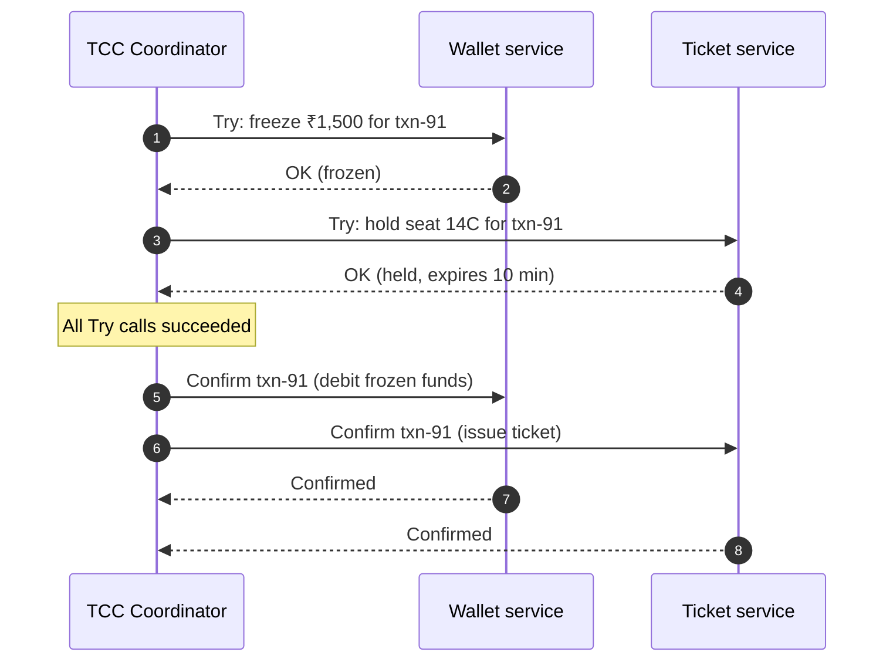
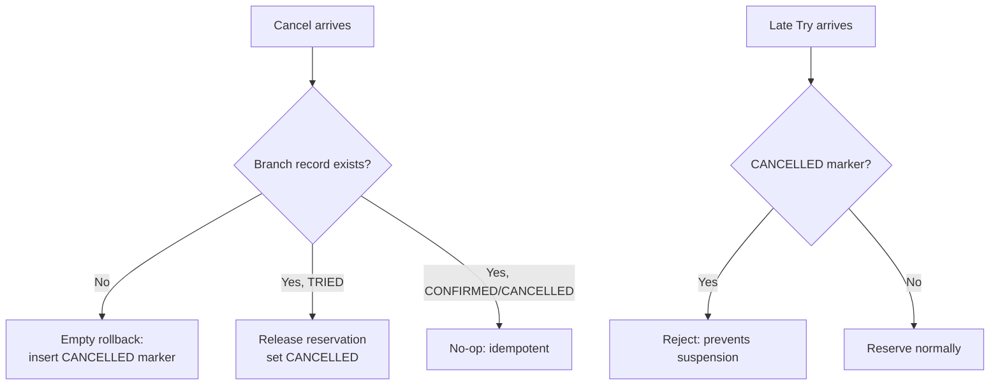

**Try-Confirm/Cancel (TCC)** is a distributed-transaction pattern that brings the *shape* of [Two-Phase Commit](/blog/two-phase-commit/) up to the business level. Instead of databases holding locks during a prepare phase, each service exposes three business operations:

- **Try** — check business rules and **reserve** the resources needed (freeze funds, hold seats, earmark stock).
- **Confirm** — turn the reservation into a final change.
- **Cancel** — release the reservation.

A coordinator calls Try on every participant. If all succeed, it calls Confirm on all; if any fails, it calls Cancel on all. Because reservations are ordinary committed rows, no database locks are held between phases.

## The problem

A [Saga](/blog/saga-pattern/) performs real changes and then compensates. That works, but it means intermediate states are *visible and real*: the customer may briefly see money leave their account before it is refunded, or another customer may be told a seat is sold that later becomes free again.

For payments, inventory, and bookings you often want something stricter: **nothing is final until everything is agreed**, but without 2PC's lock-holding and XA requirements.

## How it works



If the ticket service's Try had failed, the coordinator would call **Cancel** on the wallet (unfreeze the ₹1,500) and on the ticket service (which may have nothing to cancel — see *empty rollback* below).

### Modelling reservations

The core design move is to give every resource a "reserved" bucket alongside its "available" bucket.

| Resource | Try | Confirm | Cancel |
|---|---|---|---|
| Wallet | `available -= amt; frozen += amt` | `frozen -= amt` | `frozen -= amt; available += amt` |
| Inventory | `available -= qty; reserved += qty` | `reserved -= qty` | `reserved -= qty; available += qty` |
| Seat | `status = HELD, expires_at = now()+10m` | `status = SOLD` | `status = FREE` |

## Example: a wallet participant

Below is a Spring-style wallet service with the three TCC operations. Notice the **transaction log table** — it's what makes the operations idempotent and safe against out-of-order calls.

```sql
CREATE TABLE wallet (
  account_id  VARCHAR(40) PRIMARY KEY,
  available   NUMERIC(18,2) NOT NULL CHECK (available >= 0),
  frozen      NUMERIC(18,2) NOT NULL DEFAULT 0 CHECK (frozen >= 0)
);

CREATE TABLE tcc_branch (
  xid         VARCHAR(64) PRIMARY KEY,     -- global transaction id
  account_id  VARCHAR(40) NOT NULL,
  amount      NUMERIC(18,2) NOT NULL,
  state       VARCHAR(12) NOT NULL         -- TRIED | CONFIRMED | CANCELLED
);
```

```java
@Service
public class WalletTccService {

  private final JdbcTemplate db;

  @Transactional
  public void tryFreeze(String xid, String accountId, BigDecimal amount) {
    // Suspension guard: Cancel already ran for this xid -> refuse late Try
    if (branchState(xid).filter(s -> s.equals("CANCELLED")).isPresent()) return;

    int rows = db.update("""
        UPDATE wallet SET available = available - ?, frozen = frozen + ?
        WHERE account_id = ? AND available >= ?""",
        amount, amount, accountId, amount);
    if (rows == 0) throw new InsufficientFundsException(accountId);

    db.update("INSERT INTO tcc_branch(xid, account_id, amount, state) VALUES (?,?,?, 'TRIED')",
        xid, accountId, amount);
  }

  @Transactional
  public void confirm(String xid) {
    // Idempotent: only TRIED -> CONFIRMED moves money
    int rows = db.update("UPDATE tcc_branch SET state = 'CONFIRMED' WHERE xid = ? AND state = 'TRIED'", xid);
    if (rows == 0) return;   // already confirmed (retry) — nothing to do
    db.update("""
        UPDATE wallet w SET frozen = frozen - b.amount
        FROM tcc_branch b WHERE b.xid = ? AND w.account_id = b.account_id""", xid);
  }

  @Transactional
  public void cancel(String xid, String accountId) {
    Optional<String> state = branchState(xid);
    if (state.isEmpty()) {
      // Empty rollback: Try never arrived. Record CANCELLED so a late Try is rejected.
      db.update("INSERT INTO tcc_branch(xid, account_id, amount, state) VALUES (?,?,0,'CANCELLED')",
          xid, accountId);
      return;
    }
    int rows = db.update("UPDATE tcc_branch SET state = 'CANCELLED' WHERE xid = ? AND state = 'TRIED'", xid);
    if (rows == 0) return;   // already cancelled or confirmed
    db.update("""
        UPDATE wallet w SET frozen = frozen - b.amount, available = available + b.amount
        FROM tcc_branch b WHERE b.xid = ? AND w.account_id = b.account_id""", xid);
  }

  private Optional<String> branchState(String xid) {
    return db.query("SELECT state FROM tcc_branch WHERE xid = ?",
        rs -> rs.next() ? Optional.of(rs.getString(1)) : Optional.empty(), xid);
  }
}
```

## The three classic TCC anomalies

Networks reorder and drop messages, and coordinators retry. Every TCC participant must handle these three cases — frameworks like Seata and DTM call them out explicitly.

| Anomaly | What happens | Defence |
|---|---|---|
| **Idempotency** | Confirm or Cancel is delivered twice after a retry. | State machine in a branch table; only `TRIED → CONFIRMED/CANCELLED` transitions do work. |
| **Empty rollback** | Try timed out and never reached the participant, but the coordinator calls Cancel anyway. | Cancel with no branch record succeeds and records `CANCELLED`. |
| **Suspension (hanging)** | The delayed Try arrives *after* Cancel. Without a guard it would freeze funds forever. | Try checks for a `CANCELLED` record and refuses. |



## TCC vs. Saga vs. 2PC

| | 2PC | TCC | Saga |
|---|---|---|---|
| Where locks/reservations live | Database locks | Business reservations (committed rows) | None |
| Isolation | Full | Good — reservations hide intent | Weak — real changes visible |
| Participant effort | None (XA driver) | High — three operations per resource | Medium — action + compensation |
| Works over HTTP / any store | No | Yes | Yes |
| Blocking on coordinator failure | Yes | No — reservations can expire | No |

**Choose TCC** when the resource is naturally reservable and premature visibility is costly: money movement, ticketing, inventory for flash sales, quota allocation. **Choose a saga** when steps are long-running, involve external parties that can't reserve, or compensation is acceptable.

## Design considerations

- **Reservations must expire.** If the coordinator disappears, a reaper should Cancel tries older than their TTL. This is the [Reservation](/blog/reservation-pattern/) pattern at work, and it's what makes TCC non-blocking.
- **Confirm and Cancel must not fail on business grounds.** All validation belongs in Try. Confirm/Cancel should only fail for technical reasons and be retried until they succeed.
- **The coordinator must be durable.** It records the global transaction and each branch so it can resume Confirm/Cancel after a crash.
- **Keep Try cheap.** It runs on the hot path for every request, including those that will be cancelled.

## Common pitfalls

> **Warning:** Teams often implement Try as "do the real thing" and Cancel as "compensate it". That's a saga wearing a TCC costume — you lose the isolation benefit. Try must *reserve*, not *perform*.

- Skipping the branch table and relying on "the coordinator won't retry" — it will.
- Sharing one reservation pool across tenants without limits, letting abandoned Tries starve real traffic.
- Forgetting reporting: "available" balances shown to users must exclude frozen amounts.

## Tools and real-world usage

- **Apache Seata** — TCC mode with `@TwoPhaseBusinessAction`, plus built-in handling for empty rollback and suspension.
- **DTM** (Go) — supports TCC, Saga, XA, and outbox-style messages across languages.
- **Hmily, ByteTCC** — Java TCC frameworks popular in Chinese fintech.
- Card networks' **authorize → capture / void** flow and airline **hold → ticket / release** flows are TCC in everything but name.

## Related patterns

- [Reservation](/blog/reservation-pattern/) — the "Try" building block with expiry.
- [Saga](/blog/saga-pattern/) — the looser alternative.
- [Two-Phase Commit](/blog/two-phase-commit/) — the database-level ancestor.
- [Idempotent Consumer](/blog/idempotent-consumer/) — required for Confirm/Cancel retries.

## Key takeaways

1. TCC = reserve (Try), then finalize (Confirm) or release (Cancel).
2. It gives better isolation than a saga without 2PC's locks.
3. Every participant must handle idempotency, empty rollback, and suspension.
4. Put all business validation in Try; Confirm/Cancel must always eventually succeed.
