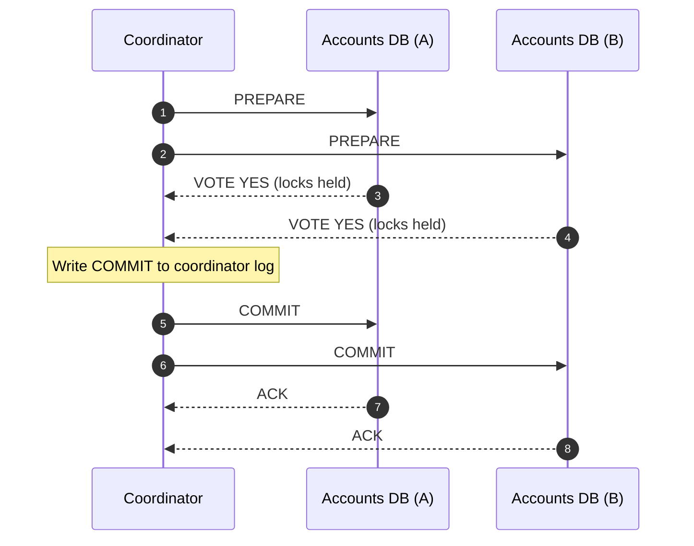
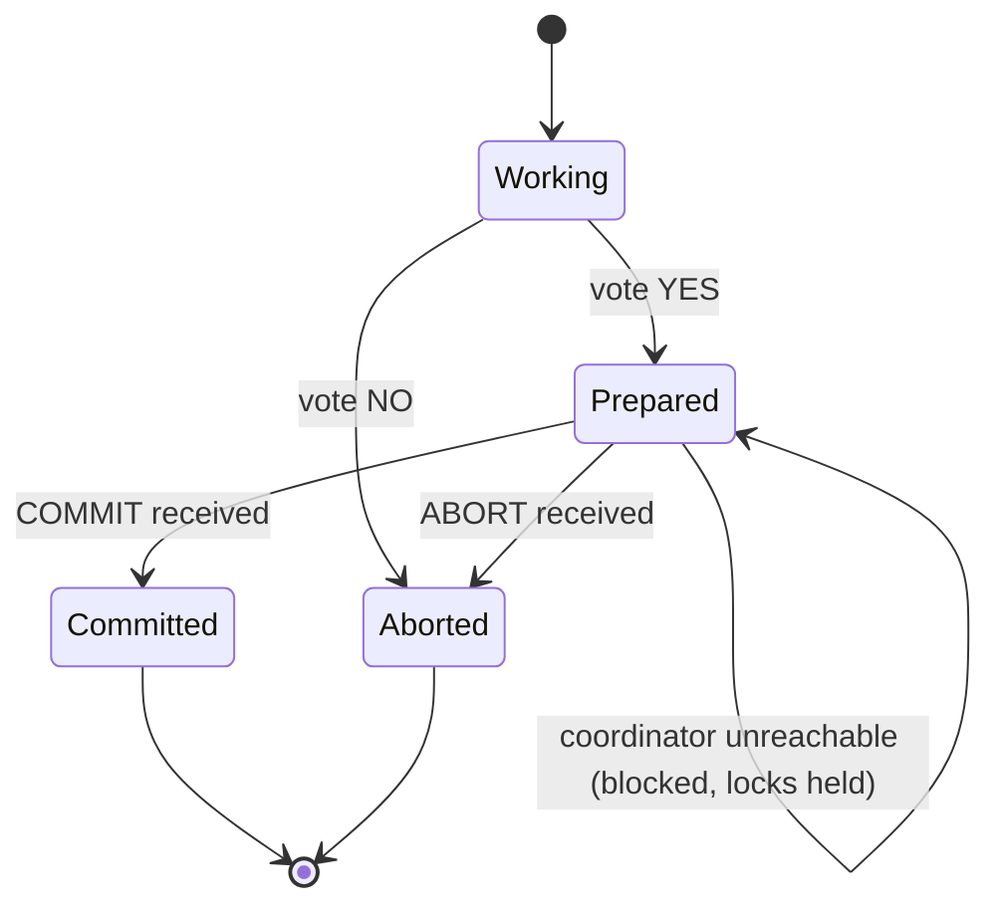

**Two-Phase Commit (2PC)** is the classic protocol for making a transaction that touches several resources — two databases, or a database and a message broker — **atomic**. Either every participant commits, or none does. It's the mechanism behind XA transactions, JTA in Java EE, and MSDTC in the .NET world.

In microservices circles 2PC has a bad reputation, and mostly for good reasons. But knowing exactly *why* it's avoided — and where it still fits — is what separates a pattern-matcher from an architect.

## The problem

You need to move money from an account in database A to an account in database B. Two separate local transactions can leave you with a debit but no credit if the process dies between them. You want the guarantee a single database gives you: **all or nothing**.

## How it works

2PC introduces a **coordinator** (transaction manager) and treats each database or broker as a **participant** (resource manager).

### Phase 1 — Prepare (voting)

The coordinator asks every participant: *"Can you commit?"* Each participant does all the work needed to guarantee it *could* commit — writes redo/undo logs, acquires locks, checks constraints — and durably records a `PREPARED` state. It then votes **Yes** or **No**.

### Phase 2 — Commit or abort (decision)

- If **every** participant voted Yes, the coordinator durably logs `COMMIT` and tells everyone to commit.
- If **any** participant voted No (or timed out), the coordinator logs `ABORT` and tells everyone to roll back.



The key property: once a participant votes Yes, it **gives up the right to decide**. It must keep its locks and wait for the coordinator — no matter how long that takes.

## Example: XA with JTA in Java

With a JTA transaction manager such as Atomikos or Narayana, application code looks like a single transaction. The manager enlists each XA-capable `DataSource` and runs the two phases on `commit()`.

```java
@Service
public class TransferService {

  private final JdbcTemplate accountsA;   // XA DataSource #1
  private final JdbcTemplate accountsB;   // XA DataSource #2

  public TransferService(@Qualifier("xaA") JdbcTemplate a,
                         @Qualifier("xaB") JdbcTemplate b) {
    this.accountsA = a;
    this.accountsB = b;
  }

  // JtaTransactionManager coordinates both resources with 2PC
  @Transactional(transactionManager = "jtaTransactionManager", timeout = 5)
  public void transfer(String from, String to, BigDecimal amount) {
    int debited = accountsA.update(
        "UPDATE account SET balance = balance - ? WHERE id = ? AND balance >= ?",
        amount, from, amount);
    if (debited == 0) throw new InsufficientFundsException(from);

    accountsB.update(
        "UPDATE account SET balance = balance + ? WHERE id = ?",
        amount, to);
    // On return: prepare(A), prepare(B), then commit(A), commit(B)
  }
}
```

You can see the raw protocol in PostgreSQL, which exposes it directly:

```sql
-- On each participant
BEGIN;
UPDATE account SET balance = balance - 100 WHERE id = 'acc-1';
PREPARE TRANSACTION 'transfer-7f3a';   -- phase 1: durable, locks retained

-- Later, driven by the coordinator
COMMIT PREPARED 'transfer-7f3a';       -- phase 2
-- or: ROLLBACK PREPARED 'transfer-7f3a';

-- Operational check for stuck ("in-doubt") transactions
SELECT gid, prepared, owner FROM pg_prepared_xacts;
```

> **Warning:** PostgreSQL ships with `max_prepared_transactions = 0`. Prepared transactions that are never resolved keep their locks and block VACUUM. If you enable 2PC, monitor `pg_prepared_xacts` and alert on anything older than a few minutes.

## Failure scenarios

2PC is correct, but its behavior under failure is what matters in production.

| Failure | What happens |
|---|---|
| Participant votes No | Coordinator aborts everyone. Clean. |
| Participant crashes **before** voting | Coordinator times out and aborts. Clean. |
| Participant crashes **after** voting Yes | On restart it finds `PREPARED` in its log and asks the coordinator for the outcome. Locks stay held until then. |
| Coordinator crashes **after** collecting votes but **before** deciding | Participants are **in doubt**. They cannot commit (someone may have voted No) or abort (the coordinator may have decided commit). They block, holding locks, until the coordinator recovers. |
| Network partition during phase 2 | Some participants commit, others wait. Eventually consistent once the partition heals — but locks are held meanwhile. |

That fourth row is the famous **blocking problem**. 2PC is *safe* but not *live*: a single coordinator failure can freeze resources indefinitely. [Three-Phase Commit](/blog/three-phase-commit/) was designed to address this, at a cost.



## Why microservices usually avoid 2PC

1. **Availability coupling.** A transaction can only commit if *every* participant and the coordinator are up. Availability multiplies: three services at 99.9% each give ~99.7% for the transaction.
2. **Lock duration.** Locks are held across network round trips. Under load, lock contention — not CPU — becomes the bottleneck.
3. **Limited support.** Kafka, most NoSQL stores, and nearly every SaaS API don't speak XA. HTTP has no prepare phase.
4. **Encapsulation.** 2PC across services means a coordinator reaches into each service's database transaction — exactly the coupling [Database per Service](/blog/database-per-service/) is meant to remove.
5. **Operational burden.** Heuristic outcomes, in-doubt transactions, and transaction-log recovery are hard to operate and rarely rehearsed.

## Where 2PC still fits

- **Inside one service** that legitimately owns two resources (e.g., a legacy service writing to Oracle and IBM MQ together). XA between a database and a broker is a long-established mainframe/banking pattern.
- **Inside distributed databases.** Spanner, CockroachDB, YugabyteDB, and TiDB run 2PC internally across shards — but pair it with consensus (Paxos/Raft) so the coordinator itself is replicated and doesn't block.
- **Short, low-contention operations** where correctness beats throughput and all participants are under one team's control.

> **Rule of thumb:** if you need 2PC *between services*, first ask whether those services should be one. If not, use a [Saga](/blog/saga-pattern/) or [TCC](/blog/try-confirm-cancel/), and use a [Transactional Outbox](/blog/transactional-outbox/) instead of XA between your database and your broker.

## Trade-offs

| Benefits | Costs |
|---|---|
| True atomicity and isolation across resources | Blocking when the coordinator fails |
| Transparent to application code (`@Transactional`) | Locks held across network round trips |
| Mature, standardized (X/Open XA, JTA) | Poor support in modern brokers, NoSQL, and HTTP APIs |
| Strong consistency — no compensation logic | Availability of the whole is lower than any part |

## Common pitfalls

- **Forgetting recovery.** The transaction manager's log *is* state. Run the coordinator on durable storage and test crash recovery.
- **Heuristic decisions.** Some resource managers will unilaterally commit or roll back an in-doubt transaction after a timeout ("heuristic commit"). That breaks atomicity silently — monitor for heuristic exceptions.
- **Long timeouts.** Keep XA transactions to milliseconds or a few seconds. A 60-second XA timeout is a lock-contention incident waiting to happen.
- **"Last resource" tricks.** Optimizations that let one non-XA resource join the transaction reintroduce a window of inconsistency. Know when your transaction manager does this.

## Tools and real-world usage

- **Atomikos, Narayana (JBoss), Bitronix** — standalone JTA transaction managers for Java.
- **Application servers** — WebSphere, WebLogic, and JBoss/WildFly ship JTA with XA recovery; this is where many banks still run 2PC between Oracle/DB2 and IBM MQ.
- **Databases** — PostgreSQL `PREPARE TRANSACTION`, MySQL `XA START/END/PREPARE/COMMIT`, Oracle and SQL Server XA.
- **Distributed SQL** — Spanner, CockroachDB, YugabyteDB implement 2PC over Raft/Paxos groups internally.

## Related patterns

- [Three-Phase Commit](/blog/three-phase-commit/) — adds a phase to reduce blocking.
- [Saga](/blog/saga-pattern/) — the common microservices alternative.
- [Try-Confirm/Cancel](/blog/try-confirm-cancel/) — 2PC-like semantics at the business level.
- [Transactional Outbox](/blog/transactional-outbox/) — avoids XA between a database and a broker.

## Key takeaways

1. 2PC = prepare (vote) + commit/abort (decide), driven by a coordinator.
2. It guarantees atomicity but **blocks** if the coordinator fails after votes are cast.
3. It couples the availability and latency of every participant.
4. Avoid it between microservices; it's still valid inside one service or inside a consensus-backed distributed database.
